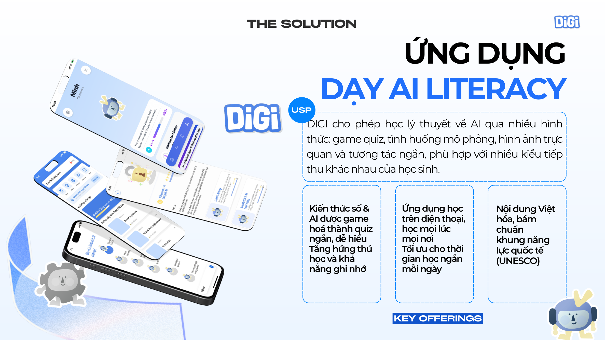

# DIGI — AI & Digital Literacy Learning Platform

**Product Discovery · MVP Validation · Product Analytics · Product Strategy**

> **Project type:** EdTech startup concept and MVP pilot  
> **Target users:** Vietnamese secondary/high-school students (ages 11–18)  
> **Customers:** Parents, with schools as a potential B2B/B2B2C channel  
> **Stage:** MVP / early validation — not a fully launched commercial product

### 🚀 Live MVP Demo

Experience DIGI's interactive learning platform through our live MVP.

**[🚀 Try DIGI — Live MVP Demo](https://ai-unlocked-app-17964.lovable.app/home)**

> This is an interactive MVP prototype developed to demonstrate DIGI's core learning experience.

## At a glance

DIGI is a proposed mobile-first learning platform that helps students develop practical AI and digital skills through short, gamified learning activities, quizzes, and scenario-based exercises.

**The product question:** How might we make practical AI literacy more accessible, engaging, and affordable for students who have limited access to structured digital-skills education?

| Product evidence | Project scope |
| --- | --- |
| **52 students** | Participated in MVP testing (confirmed project total) |
| **15 parents** | Participated in parent validation (confirmed project total) |
| **Mobile-first MVP** | Gamified quizzes and bite-sized learning |
| **Roadmap** | MVP → beta → launch → learning-path expansion |

**Evidence note:** The supplied presentation describes an earlier subset of 36 students and 14 parents. This repository uses the project totals confirmed by the project team (52 and 15). Percentage-based findings from the smaller sample are **not** applied to the larger totals without supporting updated data.

## 1. Problem & opportunity

Students increasingly encounter AI tools but lack accessible opportunities to learn how to apply them effectively. Traditional resources can be theory-heavy, fragmented, or expensive, creating a gap between awareness of technology and practical skill development.

Two user groups shaped our product concept:

- **Students:** need short, engaging and easy-to-follow learning experiences.
- **Parents:** need an affordable supplement with understandable learning outcomes.

## 2. Product discovery

We explored differences in digital-skills learning opportunities, reviewed curricula and alternatives, and used conversations with students and parents to formulate an initial product hypothesis.

**Hypothesis:** Short, interactive, gamified modules can improve learners' willingness to engage with digital-skills content, while visible progress can help parents understand its value.

See [Discovery & user needs](docs/01-discovery.md).

## 3. Proposed product

DIGI's core MVP concept combines:

- Bite-sized lessons on AI and digital skills.
- Gamified quizzes and short scenario-based practice.
- Mobile-first access designed for flexible learning.
- A proposed future progress view for students and parents.

**Important:** The feature set above includes both MVP elements and planned enhancements. See [Solution & scope](docs/02-solution.md) for this distinction.

## 4. MVP validation & insights

The project tested the learning concept with **52 students and 15 parents**, according to the confirmed project totals.

The original presentation also documents an **earlier analysis subset** (36 students and 14 parents), including an initial single-module completion measurement and qualitative feedback. Those subset rates are not generalized to all participants.

Feedback themes from the supplied proposal:
1. New learners need more guidance when first opening the app.
2. Shorter daily tasks could support repeat engagement.
3. Progress should communicate what the learner can now do, not only what they completed.
4. Parents need a clearer link between app activities and practical learning benefits.

See [MVP validation & decisions](docs/03-validation.md).

## 5. Product strategy

The proposal explores:
- **Value proposition:** accessible, localized AI literacy through learning-by-playing.
- **Revenue:** monthly/annual subscriptions, with B2B licensing as a potential extension.
- **Expansion:** more learning content, richer gamification, analytics, and possible school partnerships.

Pricing and market-sizing numbers are **business assumptions from the proposal**, not realized revenue.

See [Strategy & roadmap](docs/04-strategy.md).

## 6. What this project demonstrates

| Capability | Evidence |
| --- | --- |
| Problem discovery | Student/parent segments and education-gap research |
| Product thinking | Product hypothesis, value proposition and MVP design |
| Validation | Pilot testing, engagement-oriented measurements and feedback |
| Data-informed decisions | Converting usability and retention concerns into improvement proposals |
| Product strategy | Subscription concepts, channel hypotheses and phased roadmap |

## 7. Project role & contributions

**Team project.** This repository presents the overall project work. Individual contribution details should be added **only after the author confirms their exact ownership**, so team deliverables are not misrepresented as solo work.

See [Contribution statement](docs/05-contributions.md).

## 8. Project limitations

This is a student-led product initiative and an early-stage MVP. Its testing sample is limited, long-term commercial retention has not been established, and pricing/market projections are assumptions rather than verified business outcomes.

## Supporting materials

- [Discovery](docs/01-discovery.md)
- [Product concept & scope](docs/02-solution.md)
- [Validation & insights](docs/03-validation.md)
- [Product strategy](docs/04-strategy.md)
- [Contributions](docs/05-contributions.md)
- [Source and data notes](docs/06-sources-and-data.md)

**Public-sharing note:** Full reports and user-testing photographs are not included by default. Obtain permissions and remove participant-identifying information before publishing.
